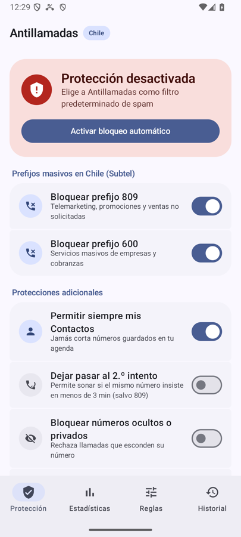
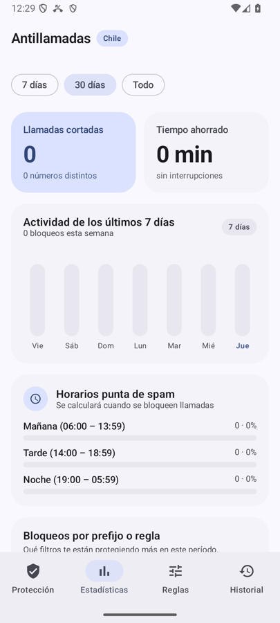
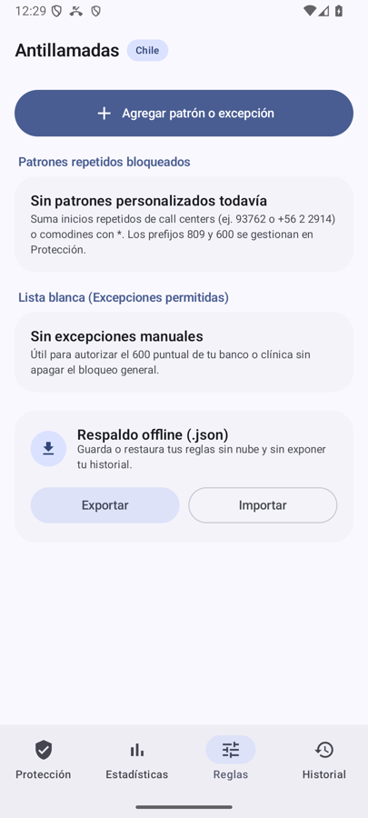
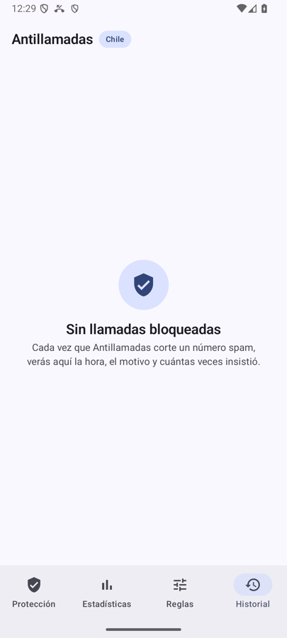

# Antillamadas Chile

App Android que corta automáticamente las llamadas spam antes de que suene el teléfono. Está pensada para la numeración chilena: bloquea de fábrica los prefijos **809** (telemarketing) y **600** (servicios masivos y cobranzas) definidos por Subtel, y te deja sumar tus propias reglas.

Todo funciona dentro del teléfono: no hay cuentas, nube ni envío de datos. El historial y las reglas se guardan solo en tu dispositivo.

<p align="center">
  
  
  
  
</p>

## Requisitos

- Android 10 (API 29) o superior.
- Para compilar: Android Studio (o JDK 17) y el SDK de Android 36.

## Instalación

### Descargar el APK (recomendado)

1. Descarga **[Antillamadas-Chile-v2.1.apk](https://github.com/Mxgsr/Antillamadas/releases/latest/download/Antillamadas-Chile-v2.1.apk)** desde la [página de Releases](https://github.com/Mxgsr/Antillamadas/releases/latest).
2. Ábrelo en el teléfono y permite instalar apps de fuentes externas cuando Android lo pida.

El APK está firmado por el autor. Puedes comprobarlo con `apksigner verify --print-certs`; el SHA-256 del certificado debe ser `dd7e9ed0d74b234f9dad70f8df7329777970ddfcb813a2cea07518b12d20b91d`.

### Compilar desde el código

```bash
git clone https://github.com/Mxgsr/Antillamadas.git
cd Antillamadas
./gradlew assembleDebug
```

El APK queda en `app/build/outputs/apk/debug/app-debug.apk`. Instálalo con:

```bash
adb install app/build/outputs/apk/debug/app-debug.apk
```

O ábrelo en el teléfono y acepta instalar desde fuentes externas.

## Primeros pasos

1. Abre **Antillamadas**. Verás el aviso *Protección desactivada*.
2. Toca **Activar bloqueo automático** y elige Antillamadas como app predeterminada de identificación de llamadas y spam. Android exige este paso: sin él, ninguna app puede rechazar llamadas.
3. (Opcional) Autoriza la lectura de Contactos para que nunca se corte a alguien de tu agenda. Esa lectura es local.
4. Listo. Las llamadas que coincidan con tus reglas se rechazan sin sonar.

## Cómo se usa

### Protección

Interruptores principales del filtro:

| Opción | Qué hace |
|---|---|
| Bloquear prefijo 809 | Telemarketing, promociones y ventas no solicitadas |
| Bloquear prefijo 600 | Servicios masivos de empresas y cobranzas |
| Permitir siempre mis Contactos | Nunca corta números guardados en tu agenda |
| Dejar pasar al 2.º intento | Si el mismo número insiste en menos de 3 minutos, lo deja sonar (salvo 809) |
| Bloquear números ocultos o privados | Rechaza llamadas sin número visible |
| Bloquear llamadas internacionales | Rechaza números fuera de +56 |

También puedes **pausar** la protección un rato y agregar el **botón rápido** a la cortina de Android (Quick Settings) para activarla o desactivarla sin abrir la app.

### Reglas

Toca **Agregar patrón o excepción** y elige:

- **Bloquear** o **Permitir** (lista blanca). Sirve, por ejemplo, para dejar pasar el 600 de tu banco o clínica sin apagar el bloqueo general del 600.
- **Modo de comparación:**
  - *Prefijo*: el número comienza con esos dígitos (`93762`, `+56 2 2914`).
  - *Comodín*: `*` equivale a cualquier secuencia y `?` a un dígito (`+569 3762 ****`).
  - *Exacto*: solo ese número.

El **simulador instantáneo** te dice qué haría el filtro con cualquier número antes de que te llame.

**Respaldo offline:** *Exportar* e *Importar* guardan o restauran tus reglas en un archivo `.json`, sin nube y sin incluir tu historial.

### Estadísticas

Llamadas cortadas, tiempo ahorrado, actividad de los últimos 7 días, horarios punta de spam, qué reglas te protegen más y los números más insistentes.

Cuando varios números desconocidos distintos comparten los mismos primeros dígitos (típico de call centers que rotan los últimos 4), la app muestra una **sugerencia inteligente** para bloquear ese prefijo con un toque.

### Historial

Cada llamada bloqueada con hora, motivo y cuántas veces insistió. Puedes buscar por número o motivo, permitir un número que se cortó por error y **copiar los datos para denunciarlo en SERNAC**.

## Privacidad

- Sin conexión a internet ni servidores.
- El único permiso es `READ_CONTACTS`, opcional, para no bloquear a tus contactos.
- Para detectar call centers se guarda una huella anónima del inicio del número, no el número completo de quien llama.
- La copia de seguridad del sistema está desactivada para que los datos no salgan del teléfono.

## Desarrollo

```bash
./gradlew test                  # pruebas unitarias
./gradlew connectedAndroidTest  # pruebas de UI (requiere emulador o dispositivo)
```

Estructura principal (`app/src/main/kotlin/cl/antillamadas/app/`):

- `domain/`: motor de filtrado, normalización de números chilenos y estadísticas.
- `data/`: almacenamiento local de reglas e historial.
- `screening/`: `CallScreeningService` que rechaza las llamadas y el botón de la cortina.
- `ui/`: interfaz en Jetpack Compose (Material 3).

### Firma de release

El build `release` usa una llave de autor si existe `keystore.properties` en la raíz (con `storeFile`, `storePassword`, `keyAlias` y `keyPassword`). Sin ese archivo se firma con la llave de debug. La llave y el script de firma no están en el repositorio.
