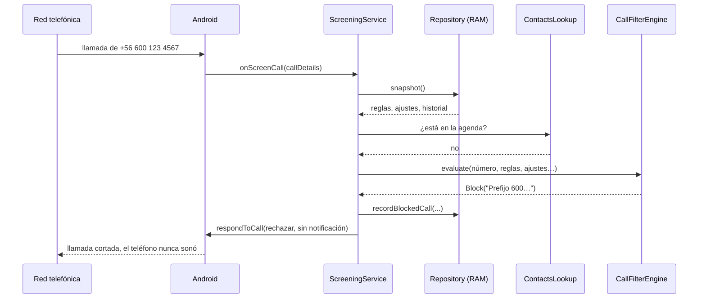
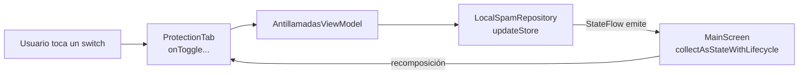

# Cómo funciona Antillamadas por dentro

Guía para entender el código de la app y, de paso, aprender a programar para Android desde cero. Supone que sabes algo de programación (C o Python al nivel de CS50), pero nada de Android ni de Kotlin.

Léela con el código abierto al lado. Cada sección apunta al archivo donde pasa lo que se explica.

---

## 1. Qué es una app Android, en cinco ideas

1. **Un APK es un ZIP.** Lleva tu código compilado, los íconos y textos, y un archivo de identidad llamado *manifest*. Android lo instala y le asigna una carpeta privada que ninguna otra app puede leer.
2. **El manifest es el contrato con Android.** En [`AndroidManifest.xml`](../app/src/main/AndroidManifest.xml) la app declara qué permisos pide y qué *componentes* tiene. Si un componente no está en el manifest, para Android no existe.
3. **Una app no es un programa con `main()`.** Es un conjunto de componentes que **Android** decide cuándo crear y cuándo destruir. Tú no llamas a tu código: Android lo llama cuando ocurre algo (el usuario abre la app, entra una llamada, se toca un botón de la cortina).
4. **Los componentes que usa esta app:**
   - **Activity**: una pantalla. Aquí hay una sola, [`MainActivity`](../app/src/main/kotlin/cl/antillamadas/app/MainActivity.kt).
   - **Service**: código que corre sin pantalla. Aquí hay dos: el que filtra llamadas y el botón de la cortina.
5. **Gradle es el `make` de Android.** Compila, descarga librerías, corre pruebas y firma el APK. Lo configuran los archivos `*.gradle.kts`, y [`gradle/libs.versions.toml`](../gradle/libs.versions.toml) fija las versiones de las librerías.

---

## 2. Mapa del proyecto

```
app/src/main/kotlin/cl/antillamadas/app/
├── MainActivity.kt          ← La única pantalla. Solo "enciende" la interfaz.
├── domain/                  ← EL CEREBRO. Kotlin puro, sin nada de Android.
│   ├── FilterModels.kt          tipos de datos: reglas, ajustes, decisiones
│   ├── PhoneNumberNormalizer.kt limpia y clasifica números chilenos
│   ├── CallFilterEngine.kt      decide: ¿bloquear o dejar sonar?
│   └── SpamStatsCalculator.kt   estadísticas y sugerencias de prefijos
├── data/                    ← LA MEMORIA. Guarda y lee datos.
│   ├── LocalSpamRepository.kt   archivo JSON privado + copia en RAM
│   └── CommunitySpamSyncService.kt  descarga de la lista SpamChile (v2.2)
├── screening/               ← EL CUERPO. Lo que habla con Android.
│   ├── AntillamadasScreeningService.kt  recibe cada llamada entrante
│   ├── AntillamadasTileService.kt       botón en la cortina superior
│   ├── CallRoleHelper.kt                pide el rol de "filtro de spam"
│   └── ContactsLookup.kt                ¿el número está en la agenda?
└── ui/                      ← LA CARA. Pantallas en Jetpack Compose.
    ├── main/  MainScreen, ProtectionTab, StatsTab, RulesTab, HistoryTab,
    │          AntillamadasViewModel
    ├── components/  piezas visuales reutilizables
    └── theme/       colores, tipografía, modo oscuro

app/src/test/        ← pruebas unitarias (corren en tu Mac, sin teléfono)
app/src/androidTest/ ← pruebas de interfaz (necesitan emulador)
app/src/main/res/    ← íconos (drawable/), textos (values/), reglas de backup (xml/)
```

Las flechas de dependencia apuntan siempre hacia adentro: `ui` y `screening` usan `data` y `domain`; `domain` no usa a nadie. Esa es la decisión de diseño más importante del proyecto, y la sección 9 explica por qué.

---

## 3. El viaje de una llamada entrante

Esto es lo que pasa en las décimas de segundo entre que alguien te llama y el teléfono suena (o no):



Paso a paso, en [`AntillamadasScreeningService.kt`](../app/src/main/kotlin/cl/antillamadas/app/screening/AntillamadasScreeningService.kt):

1. **Android despierta el servicio**, aunque la app esté cerrada. Lo puede hacer porque el manifest declara el servicio con la acción `android.telecom.CallScreeningService`, y porque tú le diste a la app el **rol** de filtro de spam (ver la sección 6).
2. **Las llamadas salientes pasan siempre**, sin evaluar nada.
3. **Lee el estado desde memoria** con `repository.snapshot()`. No toca el disco: Android exige una respuesta rápida.
4. **Consulta la agenda** solo si activaste "Permitir siempre mis Contactos".
5. **Le pide la decisión al motor** (`CallFilterEngine.evaluate`). Ver la sección 4.
6. **Actúa:**
   - `Allow` → deja sonar. Si el número no es un contacto, anota una huella anónima de sus primeros 5 dígitos (sirve para las sugerencias, sección 5.3).
   - `Block` → guarda la llamada en el historial y responde con `setRejectCall(true)` y `setSkipNotification(true)`: cortada y sin aviso de llamada perdida.
7. **Falla abierta (*fail-open*).** Todo está dentro de un `try/catch`. Si algo inesperado falla, la llamada **pasa**. Es preferible que suene un spam a perder la llamada del hospital. Fíjate también en que el `runCatching` alrededor de `recordBlockedCall` hace que, aunque el disco esté lleno, la llamada spam igual se corte.

---

## 4. El cerebro: `CallFilterEngine`

[`CallFilterEngine.kt`](../app/src/main/kotlin/cl/antillamadas/app/domain/CallFilterEngine.kt) es una sola función, `evaluate`, que recibe datos y devuelve una decisión. No lee archivos ni pregunta nada a Android: todo lo que necesita le llega como parámetro. Eso la hace fácil de probar.

### 4.1 El orden de las preguntas

El orden importa: **la primera regla que responde gana.**

| # | Pregunta | Si se cumple |
|---|---|---|
| 0 | ¿La protección está en pausa? | Deja sonar |
| 1 | ¿Es un contacto guardado (y la opción está activa)? | Deja sonar |
| 2 | ¿Coincide con una **excepción** de la lista blanca? | Deja sonar |
| 3 | ¿El número viene oculto? | Bloquea solo si activaste "números ocultos" |
| 4 | ¿Es internacional y activaste ese bloqueo? | Bloquea* |
| 5 | ¿Coincide con una regla de bloqueo (809, 600 o tuya)? | Bloquea* |
| 5b | ¿Está en la lista comunitaria SpamChile (v2.2)? | Bloquea* |
| 6 | Nada de lo anterior | Deja sonar |

\* Salvo **"Dejar pasar al 2.º intento"**: si el mismo número ya fue cortado hace menos de 3 minutos, ahora se le deja sonar (alguien que insiste tanto quizás es urgente). La excepción es el **809**, que por norma de Subtel es solo publicidad.

Por eso las excepciones (paso 2) van **antes** que los bloqueos (paso 5): así puedes bloquear todo el 600 y dejar pasar el 600 de tu banco.

### 4.2 Normalizar antes de comparar

El mismo número puede llegar como `6006001000`, `+56 600 600 1000` o `0056600…`, según la compañía telefónica. [`PhoneNumberNormalizer.kt`](../app/src/main/kotlin/cl/antillamadas/app/domain/PhoneNumberNormalizer.kt) lo convierte a una forma única:

```
raw            = "+56 600 600 1000"
cleaned        = "+566006001000"
nationalDigits = "6006001000"     ← lo que se compara con "600"
isChilean      = true
isHidden       = false
```

Un caso sutil que el código resuelve: un celular español es `+34 600…`. Sin normalizar, empezaría con "600" y se bloquearía. Como el normalizador separa el código de país, `isChilean = false` y la regla chilena del 600 no aplica. Hay una prueba para eso: `no confunde un celular espanol +34 600 con el prefijo 600 chileno`.

### 4.3 Comodines sin expresiones regulares

Las reglas aceptan `*` (cualquier cosa) y `?` (un dígito). La función `matchesWildcard` las compara con un algoritmo de **dos punteros**: recorre el texto y el patrón a la vez y recuerda la última `*` para retroceder si falla. No usa `Regex` a propósito: un patrón como `*****1` en una expresión regular mal escrita puede tardar muchísimo (*backtracking* catastrófico), y aquí el tiempo de respuesta es crítico.

---

## 5. La memoria: `LocalSpamRepository`

[`LocalSpamRepository.kt`](../app/src/main/kotlin/cl/antillamadas/app/data/LocalSpamRepository.kt) guarda **todo** en un único archivo JSON, `antillamadas_store.json`, dentro de la carpeta privada de la app (`filesDir`).

### 5.1 Dos copias: disco y RAM

- **En disco**, para que los datos sobrevivan a un reinicio.
- **En RAM**, dentro de un `MutableStateFlow`, para leer al instante y avisar a la pantalla cuando algo cambia.

Toda modificación pasa por una sola función:

```kotlin
private fun updateStore(transform: (SpamStoreData) -> SpamStoreData) {
  synchronized(lock) {                         // 1. un cambio a la vez
    val updated = transform(_state.value)      // 2. calcula el nuevo estado
    saveToDisk(updated)                        // 3. lo escribe en disco
    _state.value = updated                     // 4. lo publica en RAM → la UI se redibuja
  }
}
```

Esto importa porque el servicio de llamadas y la pantalla pueden escribir al mismo tiempo. `synchronized` es el equivalente a un *mutex* de C: garantiza que nunca se pisen.

### 5.2 Escritura atómica

`saveToDisk` escribe primero en `antillamadas_store.json.tmp` y después **renombra** ese archivo encima del original. Renombrar es instantáneo: si el teléfono se apaga a mitad de camino, queda el archivo viejo completo o el nuevo completo, nunca uno a medias.

### 5.3 Privacidad en los datos

- **Sugerencias de call centers:** cuando entra una llamada desconocida que no se bloqueó, se guardan sus **primeros 5 dígitos** y una **huella SHA-256 recortada** del número, no el número completo. Si en 14 días aparecen al menos 2 huellas distintas con el mismo inicio, la pestaña Estadísticas sugiere bloquear ese prefijo ([`SpamStatsCalculator.kt`](../app/src/main/kotlin/cl/antillamadas/app/domain/SpamStatsCalculator.kt)).
- **Límites:** máximo 1000 llamadas en el historial, 500 reglas propias y 256 KB por archivo importado. Los textos se limpian de caracteres de control. Así un archivo malicioso o un bug no puede llenar la memoria.
- **Singleton:** `getInstance()` garantiza que la pantalla y el servicio usen **el mismo** repositorio. Si hubiera dos, cada uno tendría su propia copia en RAM y se desincronizarían.

---

## 6. Permisos y roles: lo que Android exige

Android no deja que cualquier app corte llamadas. Hay tres niveles:

| Qué | Dónde se declara | Cómo se obtiene |
|---|---|---|
| **Rol** `ROLE_CALL_SCREENING` | Servicio con `BIND_SCREENING_SERVICE` en el manifest | El usuario elige la app como "Identificador de llamadas y spam" ([`CallRoleHelper.kt`](../app/src/main/kotlin/cl/antillamadas/app/screening/CallRoleHelper.kt)) |
| **Permiso peligroso** `READ_CONTACTS` | `<uses-permission>` en el manifest | Diálogo del sistema en tiempo de ejecución, al tocar el botón |
| **Permiso normal** `INTERNET` (v2.2) | `<uses-permission>` en el manifest | Se concede al instalar, sin preguntar |

Patrón que verás en [`MainScreen.kt`](../app/src/main/kotlin/cl/antillamadas/app/ui/main/MainScreen.kt): **nunca se asume** que el permiso sigue concedido. Cada vez que vuelves a la app (`ON_RESUME`) se revisa de nuevo, porque el usuario pudo quitarlo desde Ajustes.

---

## 7. La cara: interfaz con Jetpack Compose

### 7.1 La idea central: la pantalla es una función del estado

En Android antiguo se dibujaba la pantalla y luego se modificaba a mano ("cambia este texto", "oculta este botón"). **Compose** funciona al revés: escribes una función que dice *cómo se ve la pantalla para estos datos*, y cuando los datos cambian, Compose **vuelve a llamar** a la función y redibuja solo lo que cambió. Eso se llama *recomposición*.

```kotlin
@Composable
fun Saludo(nombre: String) {
  Text("Hola, $nombre")   // si `nombre` cambia, Compose redibuja este Text
}
```

### 7.2 El flujo de datos en esta app



- **Los datos bajan** como parámetros: `storeData` va de `MainScreen` a cada pestaña.
- **Los eventos suben** como funciones (*callbacks*): `onToggleRule`, `onAddRule`, etc.
- Ninguna pestaña modifica datos directamente; solo avisa hacia arriba. Esto se llama **flujo unidireccional** y evita el clásico bug de "la pantalla muestra algo distinto de lo guardado".

### 7.3 ¿Para qué sirve el ViewModel?

Cuando giras el teléfono, Android **destruye y recrea** la Activity. Todo lo que estuviera en ella se pierde. El [`AntillamadasViewModel`](../app/src/main/kotlin/cl/antillamadas/app/ui/main/AntillamadasViewModel.kt) sobrevive a esa recreación y además es el lugar donde lanzar trabajo largo (como la descarga de la lista comunitaria) con `viewModelScope.launch`, para que no se corte si la pantalla gira.

### 7.4 Tres tipos de estado

| Tipo | Ejemplo en el código | Dura… |
|---|---|---|
| `remember { mutableStateOf(...) }` | `isRoleHeld` en MainScreen | mientras la pantalla esté visible |
| `rememberSaveable { ... }` | `showCreateDialog` en RulesTab | también tras girar el teléfono |
| `StateFlow` en el repositorio | `storeState` | mientras el proceso viva, y en disco para siempre |

---

## 8. El botón de la cortina (Quick Settings Tile)

[`AntillamadasTileService.kt`](../app/src/main/kotlin/cl/antillamadas/app/screening/AntillamadasTileService.kt) es otro Service. Android lo llama cuando abres la cortina (`onStartListening`) y cuando tocas el botón (`onClick`). Al tocarlo, alterna `protectionEnabled` en el mismo repositorio, así que el cambio aparece en la app al instante.

En Android 13+ la app puede pedir "agrega mi botón a la cortina" con un diálogo del sistema. En Android 10–12 no existe esa API, así que muestra instrucciones. Este patrón se repite mucho en Android: **`if (Build.VERSION.SDK_INT >= …)`** para usar funciones nuevas sin romper teléfonos viejos.

---

## 9. Pruebas: por qué separar el cerebro del cuerpo

```bash
./gradlew testDebugUnitTest
```

Corre 28 pruebas en segundos, en tu Mac. Es posible porque `CallFilterEngine`, `PhoneNumberNormalizer` y `SpamStatsCalculator` **no importan nada de Android**: son Kotlin puro, igual que funciones de C que pruebas con `check50`.

Si el motor de decisiones viviera dentro del `ScreeningService`, para probarlo tendrías que simular una llamada telefónica real en un emulador. Separarlo convierte "probar que se bloquea el 600" en una línea:

```kotlin
val decision = CallFilterEngine.evaluate("+56 600 600 1000", BuiltInChileRules.defaults())
assertTrue(decision is FilterDecision.Block)
```

Las pruebas de [`CallFilterEngineTest.kt`](../app/src/test/kotlin/cl/antillamadas/app/domain/CallFilterEngineTest.kt) tienen nombres en español que se leen como especificación: son la mejor documentación de qué debe hacer el motor.

---

## 10. Novedad v2.2: base comunitaria SpamChile

> Estado al 30-10-2026: estos cambios están en tu carpeta **sin commitear**. La v2.1 publicada no los tiene.

- [`CommunitySpamSyncService.kt`](../app/src/main/kotlin/cl/antillamadas/app/data/CommunitySpamSyncService.kt) descarga un CSV público (`racuna/SpamChile` en GitHub, hoy unas 150 líneas), lo parsea, normaliza cada número y elimina duplicados.
- **Viene apagada.** La primera vez que la activas aparece un diálogo de consentimiento. La descarga solo ocurre cuando tocas "Actualizar lista"; no hay sincronización automática.
- La lista se guarda en el mismo JSON local (máximo 5000 números) y el motor la consulta en el paso 5b, **después** de tus excepciones y tus contactos. Una excepción tuya siempre gana a la lista comunitaria.
- Protecciones de la descarga: solo `https` (también en las redirecciones), tiempo máximo de 8 s, tope de 2 MB y textos recortados a 40 caracteres.
- Para esto la app ahora declara el permiso `INTERNET`.

### Un error de seguridad que ya se corrigió

La primera versión de la v2.2 tenía un problema en **Importar**: copiaba del archivo *todos* los ajustes, incluida la dirección de la lista comunitaria. Alguien podía pasarte un "respaldo" que apuntara a una lista falsa, activada y con el consentimiento ya marcado, y hacer que tu teléfono cortara, por ejemplo, el número de tu banco.

El arreglo está en `sanitizeImportedSettings` ([`LocalSpamRepository.kt`](../app/src/main/kotlin/cl/antillamadas/app/data/LocalSpamRepository.kt)): los ajustes importados se aceptan, pero cuatro campos se conservan del teléfono (la pausa y los tres de la base comunitaria). La prueba `importar un respaldo ajeno no cambia la lista comunitaria ni pausa la proteccion` lo verifica.

La lección general: **todo lo que entra desde afuera** (un archivo, una descarga, el número que llama) **es un dato de un desconocido.** El código ya limpiaba las *reglas* importadas, pero al agregar ajustes nuevos nadie se preguntó si debían importarse. Cada vez que sumes un campo a `FilterSettings`, hazte esa pregunta.

---

## 11. Kotlin para quien viene de C o Python

| Concepto | C / Python | Kotlin (con ejemplo del proyecto) |
|---|---|---|
| Variable que no cambia | `const int` | `val raw = rawInput?.trim()` |
| Variable que cambia | `int x` / `x = 1` | `var tIndex = 0` |
| Struct | `struct` / `@dataclass` | `data class FilterRule(val id: String, …)` |
| Valor que puede faltar | `NULL` / `None` | `String?` — el compilador te **obliga** a revisar |
| Si es null, usa otro valor | `x ? x : y` / `x or y` | `rawInput ?: ""` (operador Elvis) |
| Llama solo si no es null | `if (p) p->f()` | `callDetails.handle?.schemeSpecificPart` |
| `switch` | `switch` / `match` | `when (decision) { is Allow -> …; is Block -> … }` |
| Enum con datos distintos | `union` + tag | `sealed interface FilterDecision` |
| Función como parámetro | puntero a función / lambda | `onToggle: (Boolean) -> Unit` |
| Copia con un cambio | copiar y modificar | `settings.copy(protectionEnabled = false)` |
| Trabajo en segundo plano | hilos | `suspend fun` + `withContext(Dispatchers.IO)` |

Dos ideas que te van a costar al principio y valen la pena:

- **Inmutabilidad.** Casi todo es `val` y `data class`. Para "cambiar" algo se crea una copia con `.copy(...)`. Eso es lo que permite que `updateStore` sea seguro entre hilos y que Compose detecte cambios.
- **Corrutinas.** Una `suspend fun` puede pausarse sin bloquear el hilo. `withContext(Dispatchers.IO)` mueve la descarga de red fuera del hilo de la pantalla. Si descargaras en el hilo principal, la app se congelaría y Android mostraría "La app no responde".

---

## 12. Cómo trabajar en este proyecto

### Herramientas

- **Android Studio**: el editor oficial. Abre la carpeta del proyecto y él configura Gradle solo.
- **Emulador**: un teléfono virtual. En este Mac ya existe uno, `medium_phone`.
- **adb**: la "terminal" hacia el teléfono. Instala APKs, saca capturas y lee logs.

### Comandos del día a día

```bash
./gradlew assembleDebug        # compila un APK de prueba
./gradlew installDebug         # lo compila y lo instala en el emulador o teléfono conectado
./gradlew testDebugUnitTest    # pruebas rápidas del cerebro
adb logcat | grep -i antillamadas   # ver mensajes y errores en vivo
```

### Simular una llamada en el emulador

En Android Studio, con el emulador abierto: **⋯ (Extended controls) → Phone**, escribe `+56600123456` y toca **Call device**. Si la app tiene el rol activado, la llamada se corta sola y aparece en Historial.

### Debug vs. release

- **Debug** se firma con una llave genérica de Android Studio. Sirve para probar.
- **Release** se firma con tu llave de autor (`antillamadas-autor.p12`, fuera del repositorio). Android exige que cada actualización venga firmada con **la misma llave** que la versión instalada; por eso, si la pierdes, nadie podrá actualizar la app sin desinstalarla.
- Antes de publicar, sube `versionCode` (un entero que solo crece) y `versionName` (el texto visible) en [`app/build.gradle.kts`](../app/build.gradle.kts).

---

## 13. Ejercicios para aprender con este código

Van de menor a mayor. Haz cada uno, corre las pruebas y prueba en el emulador.

1. **Cambia un texto.** Busca "Tiempo ahorrado" en `StatsTab.kt` y cámbialo. Compila e instala. Objetivo: el ciclo editar → compilar → ver.
2. **Lee una prueba y rómpela a propósito.** En `CallFilterEngineTest.kt`, cambia `"600"` por `"601"` en una prueba del 600 y córrela. Mira cómo te avisa Gradle. Después déjala como estaba.
3. **Escribe tu propia prueba.** Agrega una prueba que verifique que `PhoneNumberNormalizer.formatForDisplay("912345678")` devuelve `"+56 9 1234 5678"`.
4. **Agrega un ajuste.** Crea en `FilterSettings` un ajuste nuevo (por ejemplo, bloquear números fijos de Santiago, que empiezan con `2`). Tendrás que tocar el modelo, el motor, el ViewModel y una pestaña: es el recorrido completo de una funcionalidad.
5. **Mueve la lista comunitaria a un `Set`.** Hoy el motor busca con `communitySpamList.find { … }`, que recorre la lista entera en cada llamada. Con 150 números da igual; piensa qué cambiaría con 50 000.

---

## 14. Glosario

| Término | Significado |
|---|---|
| **APK** | El archivo instalable de una app Android |
| **Activity** | Una pantalla de la app |
| **Service** | Código que corre sin pantalla, despertado por Android |
| **Manifest** | Archivo donde la app declara permisos y componentes |
| **Rol** | Permiso especial que solo una app a la vez puede tener (ej. filtro de spam) |
| **Composable** | Función que describe una parte de la pantalla |
| **Recomposición** | Compose vuelve a llamar a un Composable porque cambiaron sus datos |
| **ViewModel** | Objeto que guarda el estado de la pantalla y sobrevive a giros |
| **StateFlow** | Valor observable: avisa a quien lo escucha cada vez que cambia |
| **Corrutina** | Tarea que puede pausarse sin bloquear un hilo |
| **Gradle** | Sistema que compila, prueba y empaqueta la app |
| **Fail-open** | Ante un error, permitir en vez de bloquear |
